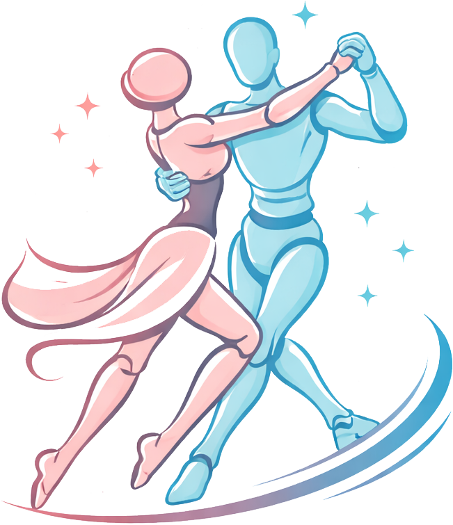
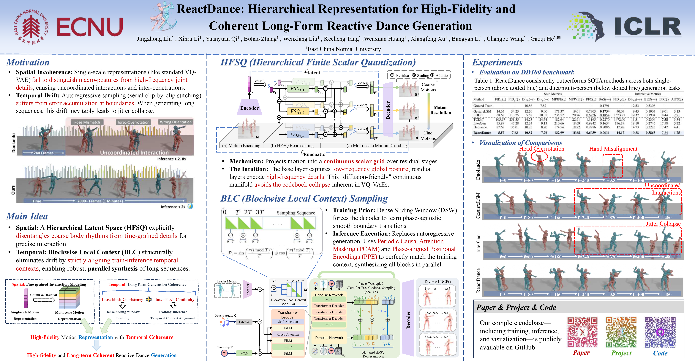

<div align="center">
  
  <h1>ReactDance: Hierarchical Representation for High-Fidelity and Coherent Long-Form Reactive Dance Generation (ICLR 2026)</h1>
</div>

<div align="center">

[](https://arxiv.org/abs/2505.05589) [](https://ripemangobox.github.io/ReactDance/) [](https://github.com/RipeMangoBox/ReactDance)

</div>



[[Project Page](https://ripemangobox.github.io/ReactDance/)] [[Paper](https://arxiv.org/abs/2505.05589)] [[Contact](mailto:ripemangobox@gmail.com)]

This repository contains the official implementation of **[ReactDance: Hierarchical Representation for High-Fidelity and Coherent Long-Form Reactive Dance Generation (ICLR 2026)](https://ripemangobox.github.io/ReactDance/)**.

ReactDance tackles long-form *reactive* dance generation, where a dancer responds to music and partner motions with coherent, high-quality movements over long horizons.

✨ If you find this repository helpful, please consider giving it a star. ✨

---

## Installation and Setup

We recommend Linux, Python 3.10, and PyTorch 2.1 with CUDA 12.1.

```bash
conda env create -f environment.yml
conda activate reactdance-v2
```

Run the commands below from the repository root. Paths in the configs and commands are relative to that root.

## Download the Dataset

Download `ReactDance_data_lazy_minimal.zip` from [Hugging Face](https://huggingface.co/datasets/RipeMangoBox/ReactDance) and extract it in the repository root. The resulting `data_lazy/` directory contains 133 training pairs, 34 test pairs, music features, test-set audio, and normalization statistics. The full distribution includes this directory.

---

## Download the Checkpoints

| Model | Checkpoint |
| --- | --- |
| HFSQ | [hfsq.ckpt](https://huggingface.co/datasets/RipeMangoBox/ReactDance/resolve/main/checkpoints/hfsq.ckpt) |
| ReactDance | [reactdance.ckpt](https://huggingface.co/datasets/RipeMangoBox/ReactDance/resolve/main/checkpoints/reactdance.ckpt) |

The full distribution includes both files. To download them into a source checkout, run the following commands.

```bash
curl -fL --create-dirs -o results/lightning_log/HFSQ/version_0/hfsq.ckpt \
  https://huggingface.co/datasets/RipeMangoBox/ReactDance/resolve/main/checkpoints/hfsq.ckpt
curl -fL --create-dirs -o results/lightning_log/ReactDance/version_0/reactdance.ckpt \
  https://huggingface.co/datasets/RipeMangoBox/ReactDance/resolve/main/checkpoints/reactdance.ckpt
```

---

## Training

### Stage One: HFSQ

```bash
python hfsq.py --config configs/hfsq.yaml
```

### Stage Two: ReactDance

```bash
python reactdance.py --config configs/reactdance.yaml
```

Each entry point loads the config shown above by default. To change the batch size, optimizer, learning rate, training length, or GPU settings, edit the YAML or pass another file with `--config`. Stage Two uses the latest HFSQ checkpoint by default. Set `hfsq_checkpoint` in the YAML to select a specific one.

Runs are saved under `results/lightning_log/<Model>/version_N/`. Each save writes a numbered weight file and a matching `.state.pt` training-state file. Keep both and pass `--resume` the `.ckpt` path to continue a run. Inference only needs the `.ckpt`.

```bash
tensorboard --logdir results/lightning_log
```

---

## Inference

These commands reconstruct or generate all 34 sequences in the test set using the released checkpoints.

```bash
python hfsq.py --mode sample --checkpoint results/lightning_log/HFSQ/version_0/hfsq.ckpt
python reactdance.py --mode sample --checkpoint results/lightning_log/ReactDance/version_0/reactdance.ckpt
```

Results are written to `results/lightning_log/<Model>/evaluation/version_0/<checkpoint-name>/`. The `pos3d_npy/` directory contains paired motion files, with `*_00.npy` for the follower and `*_01.npy` for the leader.

---

## Evaluation and Rendering

Inference writes the full-test-set metrics to `metrics.json`. Use the commands below to recompute metrics or render the full test set from saved predictions. Rendered MP4s are saved in `videos/` alongside the motion files.

```bash
python hfsq.py --mode evaluate --checkpoint results/lightning_log/HFSQ/version_0/hfsq.ckpt
python reactdance.py --mode evaluate --checkpoint results/lightning_log/ReactDance/version_0/reactdance.ckpt

python hfsq.py --mode render --checkpoint results/lightning_log/HFSQ/version_0/hfsq.ckpt
python reactdance.py --mode render --checkpoint results/lightning_log/ReactDance/version_0/reactdance.ckpt
```

## Citation

If you use this repository in your research, please cite:

```text
@inproceedings{lin2026reactdance,
  title={ReactDance: Hierarchical Representation for High-Fidelity and Coherent Long-Form Reactive Dance Generation},
  author={Jingzhong Lin and Xinru Li and Yuanyuan Qi and Bohao Zhang and Wenxiang Liu and Kecheng Tang and Wenxuan Huang and Xiangfeng Xu and Bangyan Li and Changbo Wang and Gaoqi He},
  booktitle={The Fourteenth International Conference on Learning Representations},
  year={2026},
  url={https://openreview.net/forum?id=FvMyAMbbX0}
}
```

---

## Acknowledgments

We would like to acknowledge **Xinru Li** and **Yuanyuan Qi** for their help with demo visualization and figure design, as well as **Bohao Zhang**, **Wenxiang Liu**, and **Kecheng Tang** for helpful discussions regarding writing. We also appreciate the input of **Wenxuan Huang** in research exchanges, and thank **Changbo Wang** and **Gaoqi He** for their supervisory advice throughout the project.

This work is partially supported by:

- Natural Science Foundation of China (Grant No. 62472178)
- Open Projects Program of State Key Laboratory of Multimodal Artificial Intelligence Systems (No. MAIS2024111)
- Fundamental Research Funds for the Central Universities
- Science and Technology Commission of Shanghai Municipality (Grant No. 25511107200)

## Contact

- **Technical questions:** please [open an issue](https://github.com/ripemangobox/ReactDance/issues).
- **Other inquiries:** [ripemangobox@gmail.com](mailto:ripemangobox@gmail.com)
