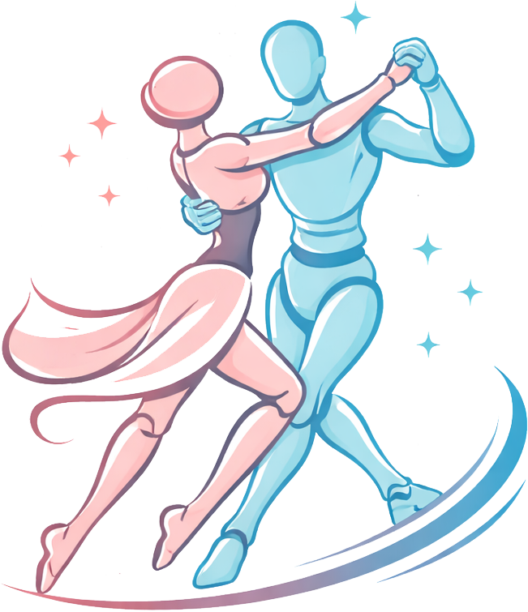
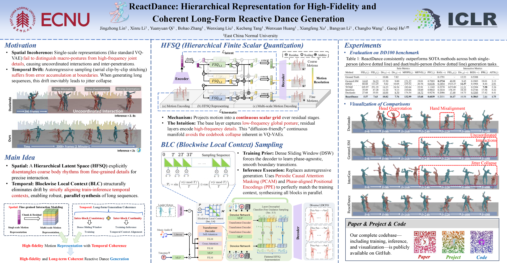

<div align="center">
  
  <h1>ReactDance: Hierarchical Representation for High-Fidelity and Coherent Long-Form Reactive Dance Generation (ICLR 2026)</h1>
</div>

<div align="center">

[](https://arxiv.org/abs/2505.05589) [](https://ripemangobox.github.io/ReactDance/) [](https://github.com/RipeMangoBox/ReactDance)

</div>



[[Project Page](https://ripemangobox.github.io/ReactDance/)] [[Paper](https://arxiv.org/abs/2505.05589)] [[Contact](mailto:ripemangobox@gmail.com)]

This repository contains the official implementation of **[ReactDance: Hierarchical Representation for High-Fidelity and Coherent Long-Form Reactive Dance Generation (ICLR 2026)](https://ripemangobox.github.io/ReactDance/)**.

ReactDance tackles long-form *reactive* dance generation, where a dancer responds to music and partner motions with coherent, high-quality movements over long horizons.

✨ If you find this repository helpful, please consider giving it a star. ✨

---

## Installation and Setup

We recommend using **Python 3.8** and **PyTorch 2.1.0 with CUDA 12.1**.

```bash
conda env create -f environment.yml
```

If the above command gets stuck when downloading or creating the environment, you can try the following manual steps:

```bash
conda create -n reactdance python=3.8
conda activate reactdance
conda install pytorch==2.1.0 torchvision==0.16.0 torchaudio==2.1.0 pytorch-cuda=12.1 -c pytorch -c nvidia
conda env update -f environment.yml
```

**Notes:**

- **matplotlib version**: newer versions of matplotlib may not be compatible; `3.1.1` has been tested to work.
- **Visualization dependencies**: ffmpeg and MoviePy are required for rendering videos.
  - Install ffmpeg:

    ```bash
    conda install -c conda-forge x264 ffmpeg -c conda-forge --override-channels
    ```
  - Install MoviePy:

    ```bash
    conda install -c conda-forge moviePy==1.0.3 --override-channels
    ```

Please make sure other dependencies are installed according to your package management setup (e.g., `pip install -r requirements.txt` if provided).

## Download the Dataset

You can download the dataset from the [Google Drive link](https://drive.google.com/file/d/18ko8x7whkR0M0bc19AQQNsvp5jmnNDSe/view?usp=drive_link), or follow [Duolando](https://github.com/lisiyao21/Duolando) to process the data yourself and rename the directory as `data_lazy`. Put `data_lazy` in the working directory:

```text
ReactDance
  ├── configs
  ├── data_lazy
  ├── datasets
  ├── ...
```

- **GT Visualization**: You can check the visualization of GT in `./data_lazy/motion/GT_vis`, or run the visualization yourself:

  ```bash
  python vis_gt.py
  ```

---

## Training

ReactDance training consists of **two stages**: first training the hierarchical feature VQ module (**HFSQ**), then training the full **ReactDance** model.

### Stage One: HFSQ

```bash
python hfsq.py --config ./configs/hfsq128_512_q2.yaml --mode train
```

Once trained, the HFSQ result directory will look like:

```text
results/training
    └── HFSQ/lightning_logs/hfsq128_512_q2
        ├── checkpoints
        │   ├── epoch_050.ckpt
        │   ├── epoch_100.ckpt
        │   ├── epoch_150.ckpt
        │   └── epoch_200.ckpt
        └── hfsq128_512_q2.yaml
```

### Stage Two: ReactDance

```bash
python reactdance.py --config ./configs/reactdance.yaml --mode train
```

After both HFSQ and ReactDance are trained, the results directories will look like:

```text
results/training
    ├── HFSQ/lightning_logs/hfsq128_512_q2
    │   ├── normalizers
    │   │   └── epoch_200
    │   │       └── normalizer.pt
    │   ├── checkpoints
    │   │   ├── epoch_050.ckpt
    │   │   ├── epoch_100.ckpt
    │   │   ├── epoch_150.ckpt
    │   │   └── epoch_200.ckpt
    │   └── hfsq128_512_q2.yaml
    └── ReactDance/lightning_logs/reactdance
        ├── checkpoints
        │   ├── epoch_050.ckpt
        │   ├── epoch_100.ckpt
        │   ├── epoch_150.ckpt
        |   ├── ...
        │   └── epoch_500.ckpt
        ├── hfsq128_512_q2.yaml
        └── reactdance.yaml
```

---

## Inference

### Stage One: HFSQ Reconstruction

1. Put your HFSQ checkpoint in `data-test-checkpoint` in`results/training/HFSQ/lightning_logs/hfsq128_512_q2/hfsq128_512_q2.yaml`.
2. Set it as `HFSQ_config` in `configs/reactdance.yaml`.

Then run:

```bash
python hfsq.py --config ./`results/training/HFSQ/lightning_logs/hfsq128_512_q2/hfsq128_512_q2.yaml` --mode duet_sample
```

Then the reconsturcted motion files and visualizations are available in

```text
results/generated/HFSQ/hfsq128_512_q2/epoch_200.ckpt/samples/duet/
    ├── pos3d_npy
    └── videos
```

### Stage Two: ReactDance Sampling

1. Put your ReactDance checkpoint in `data-test-checkpoint` in
   `results/training/ReactDance/lightning_logs/reactdance/reactdance.yaml`.

Then run:

```bash
python reactdance.py --config ./`results/training/ReactDance/lightning_logs/reactdance/reactdance.yaml` --mode sample
```

Then the sampled motion files and visualizations are available in

```text
results/generated/ReactDance/reactdance/epoch_500.ckpt/samples/
    ├── pos3d_npy
    └── videos
```

---

## Evaluation

### Solo Metrics

`utils/metrics.py` evaluates **solo** motion quality on `pos3d_npy` folders (FID_k / FID_g/ DIV_k / DIV_g / BA).

1. Edit the following variables in `utils/metrics.py` (near the bottom):

   - `gt_root` (default: `data_lazy/motion/pos3d/test`)
   - `music_root` (default: `data_lazy/music/feature/test`)
   - `pred_roots`: a list of `pos3d_npy` folders you want to evaluate.

   The script already contains example entries:

   - `results/generated/HFSQ/hfsq128_512_q2/epoch_200.ckpt/samples/duet/pos3d_npy` (HFSQ reconstruction)
   - `results/generated/ReactDance/reactdance/epoch_500.ckpt/samples/pos3d_npy` (ReactDance sampling)
2. Run:

```bash
python utils/metrics.py
```

### Duet Metrics

`utils/metrics_duet.py` evaluates **duet interaction** metrics on `pos3d_npy` folders (FID_cd / DIV_cd / MPJPE / MPJVE / Jitter / BE).

1. Edit `gt_root` and `pred_roots` in `utils/metrics_duet.py` (near the bottom). Each `pred_root` should point to a `pos3d_npy` folder that contains paired files:

   - follower: `*_00.npy`
   - leader: `*_01.npy`
2. Run:

```bash
python utils/metrics_duet.py
```

## Citation

If you use this repository in your research, please cite:

```text
@inproceedings{lin2026reactdance,
  title={ReactDance: Hierarchical Representation for High-Fidelity and Coherent Long-Form Reactive Dance Generation},
  author={Jingzhong Lin and Xinru Li and Yuanyuan Qi and Bohao Zhang and Wenxiang Liu and Kecheng Tang and Wenxuan Huang and Xiangfeng Xu and Bangyan Li and Changbo Wang and Gaoqi He},
  booktitle={The Fourteenth International Conference on Learning Representations},
  year={2026},
  url={https://openreview.net/forum?id=FvMyAMbbX0}
}
```

---

## Acknowledgments

We would like to acknowledge **Xinru Li** and **Yuanyuan Qi** for their help with demo visualization and figure design, as well as **Bohao Zhang**, **Wenxiang Liu**, and **Kecheng Tang** for helpful discussions regarding writing. We also appreciate the input of **Wenxuan Huang** in research exchanges, and thank **Changbo Wang** and **Gaoqi He** for their supervisory advice throughout the project.

This work is partially supported by:

- Natural Science Foundation of China (Grant No. 62472178)
- Open Projects Program of State Key Laboratory of Multimodal Artificial Intelligence Systems (No. MAIS2024111)
- Fundamental Research Funds for the Central Universities
- Science and Technology Commission of Shanghai Municipality (Grant No. 25511107200)

## Contact

- **Technical questions:** please [open an issue](https://github.com/ripemangobox/ReactDance/issues).
- **Other inquiries:** [ripemangobox@gmail.com](mailto:ripemangobox@gmail.com)
